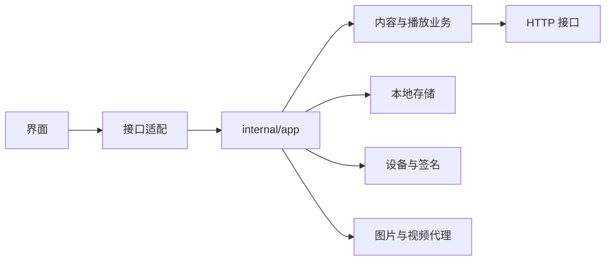

<p align="center">
  
</p>

<h1 align="center">短剧电脑版</h1>

<p align="center">输入联想 · 沉浸播放 · 本地记录</p>

<p align="center">
  
  
  
  
  
</p>

<p align="center">
  <a href="#快速开始">快速开始</a> ·
  <a href="#构建与检查">开发构建</a> ·
  <a href="#代码结构">代码结构</a> ·
  <a href="#前端开发">前端开发</a> ·
  <a href="#当前限制">当前限制</a>
</p>

---

一款基于 **Go + Wails + Vue** 的 Windows 短剧桌面客户端。将推荐浏览、搜索找剧、剧集播放和本地观看记录集中在一个窗口中，当前为 **正式版 1.0.0**。

## 功能亮点

| | 功能 | 说明 |
|:---:|---|---|
| 🎬 | 推荐浏览 | 信息流、滚轮切剧、剧名标签与内容分类 |
| 🔎 | 搜索找剧 | 输入联想、封面展示、条件筛选与分页加载 |
| 🔥 | 热门与新剧 | 排行榜、新剧、剧集详情、选集与相关推荐 |
| ▶️ | 视频播放 | 清晰度切换、播放进度、历史记录与失败恢复 |
| 💬 | 互动与账号 | 评论、弹幕、扫码登录与短信登录 |
| 📚 | 本地管理 | 收藏、点赞、追更、预约和下载任务 |

图片通过本机代理完成缓存与格式转换；播放请求支持设备切换、备用地址和自动恢复。

## 快速开始

直接打开 `dist/短剧电脑版-1.0.0.exe`，或使用默认构建产物 `dist/短剧电脑版.exe`。在源码目录中也可以双击 `Start.cmd` 启动默认构建产物。

> **Windows 11 用户通常可以直接运行。** WebView2 Runtime 随 Windows 11 预装；只要系统组件正常，无需额外安装开发环境，也无需首次展开运行组件。[微软说明](https://learn.microsoft.com/en-us/microsoft-edge/webview2/concepts/evergreen-vs-fixed-version)

| 项目 | 要求 |
|---|---|
| 系统 | Windows 64 位；推荐 Windows 11 |
| 界面组件 | 系统已有的 WebView2 Runtime |
| 网络 | 搜索、内容加载与在线播放需要联网 |
| 开发环境 | 仅运行 EXE 时不需要 Go、Node.js 或 Python |

程序不会下载、安装或展开 WebView2；系统缺少可用组件时，会提示无法启动。

命令行参数：

| 参数 | 作用 |
|---|---|
| `--web` | 使用本机 HTTP 服务提供相同界面 |
| `--port` | 浏览器模式端口，默认 `34116`；`0` 表示随机端口 |
| `--data-dir` | 指定独立数据目录 |

```powershell
# 桌面模式，使用独立数据目录
.\dist\短剧电脑版-1.0.0.exe --data-dir C:\DuanjuData

# 浏览器模式：启动后访问 http://127.0.0.1:34116
.\dist\短剧电脑版-1.0.0.exe --web --port 34116
```

`Preview.cmd` 会启动默认构建产物的浏览器模式并打开预览地址。本机服务仅监听回环地址。

## 构建与检查

开发构建需要 Windows、PowerShell、**Go 1.25+** 和 **Node.js 20+**。

在项目根目录运行：

```powershell
.\Build.ps1
```

脚本优先使用工作区中的 `../.tools/go/bin/go.exe`，不存在时使用系统 Go。构建依次执行：

1. 生成多尺寸图标与 Windows 版本资源。
2. 校验正式界面资源，生成前端产物并检查 118 个接口绑定。
3. 运行前端适配测试、Go 测试和 `go vet`。
4. 生成 `dist/短剧电脑版.exe` 并输出 SHA256。

正式界面的构建只使用 Node.js 内置模块，无需先执行 `npm install`。首次构建可能需要下载 Go 依赖。

```powershell
# 指定版本与输出位置，也可避免覆盖正在运行的 EXE
.\Build.ps1 -Version 1.0.0 -OutputPath dist/短剧电脑版-1.0.0.exe

# 开发时跳过测试和静态检查，仍执行资源校验与编译
.\Build.ps1 -SkipChecks
```

版本默认读取 `wails.json` 的 `info.productVersion`，同时写入应用版本与 Windows 文件资源。维护默认版本时，同步更新 `internal/app/app.go`、`wails.json`、`frontend/package.json` 和 `frontend/package-lock.json`。

`scripts/build.sh`、`scripts/check.sh` 以及 CI、Release 工作流均复用 `Build.ps1`。CI 另行执行包级竞态检测，该检查需要 CGO 和 GCC。Release 发布 EXE 与 SHA256 摘要。

## 代码结构

| 路径 | 职责 |
|---|---|
| `main.go` | 桌面窗口、本机预览服务与启动参数 |
| `internal/app/` | 界面绑定、生命周期、账号、设置、播放、下载和设备管理 |
| `pkg/service/` | 内容业务编排与缓存 |
| `pkg/hgapi/` | 内容接口封装、响应解析与播放请求调度 |
| `pkg/api/` | HTTP 会话、接口注册、请求参数与响应处理 |
| `pkg/register/`、`pkg/crypto/` | 设备注册、请求签名与加密处理 |
| `pkg/media/` | 本机媒体代理、图片转换、视频解密、Range 传输与地址切换 |
| `pkg/store/`、`pkg/model/` | SQLite 存储与公共数据结构 |
| `pkg/updproto/` | 更新索引、版本比较与签名工具 |
| `frontend/assets/` | 正式界面资源及完整性清单 |
| `frontend/compat/` | 正式界面与 Go 后端之间的接口适配 |
| `frontend/src/` | 可编辑 Vue 界面的页面、组件、路由与状态 |
| `frontend/public/` | 可编辑界面的静态资源 |
| `frontend/dist/` | 正式界面构建产物，由 Go 嵌入 EXE |
| `frontend/editable-dist/` | 独立的 Vue 开发构建产物 |
| `build/`、`tools/appresources/` | 图标源文件与 Windows 资源生成工具 |
| `cmd/` | 登录、注册、上游接口与媒体诊断工具 |
| `scripts/` | 前端构建、资源清单、测试与构建包装脚本 |
| `.github/workflows/` | CI 检查与发布配置 |
| `third_party/` | 第三方依赖许可 |

调用关系：



应用层的接口按职责分文件：`api_account.go` 负责账号，`api_content.go` 负责内容，`api_playback.go` 负责播放，`api_downloads.go` 负责下载，`api_settings.go` 负责设置，`api_system.go` 负责系统信息。`bindings.go` 声明界面接口，测试检查接口数量、实现和参数是否一致。

播放设备池、播放请求调度和失败恢复分别位于 `internal/app/playback_sessions.go`、`pkg/hgapi/playback_routes.go` 与 `internal/app/playback_recovery.go`。设备失败后移除并持续补充，补充过程保留请求间隔与服务端退避。

## 前端开发

### 正式界面

EXE 使用 `frontend/assets/` 中的资源，通过 `frontend/compat/bridge.js` 连接后端。`manifest.json` 记录资源大小与 SHA256。

修改正式界面资源后，在项目根目录运行：

```powershell
node scripts/update-assets-manifest.mjs
node scripts/build-frontend.mjs
```

修改适配桥无需更新资源清单。正式构建先校验资源，再清理并生成 `frontend/dist/`；需要打包 EXE 时运行 `Build.ps1`。

### 可编辑 Vue 界面

```powershell
npm --prefix frontend ci
npm --prefix frontend run dev
npm --prefix frontend run build:editable
npm --prefix frontend run preview
```

开发服务器使用 `5173` 端口，预览服务器使用 `4173` 端口。纯浏览器开发使用本地模拟数据；需要真实后端时，使用 EXE 的 `--web` 模式预览正式界面。

`build:editable` 输出到 `frontend/editable-dist/`，不会覆盖正式界面，也不会自动替换 EXE 中的资源。`npm --prefix frontend run build` 执行的仍是正式资源构建。两种产物目录均由工具生成，不应直接编辑。

## 数据与图标

全新运行时，本地数据默认位于 `%LOCALAPPDATA%\duanju-desktop`，保存账号状态、设置、收藏、历史、播放进度、设备资料、下载任务和媒体缓存。已有安装会继续复用原数据目录。开发与测试可通过 `--data-dir` 使用独立目录。

应用图标源文件为 `build/appicon.png`。`tools/appresources` 生成多尺寸 ICO、Windows 资源对象和标题栏使用的 PNG。更换图标后先生成资源，再更新前端清单并重新构建：

```powershell
go -C tools/appresources run . -root ../.. -arch amd64
node scripts/update-assets-manifest.mjs
.\Build.ps1
```

## 当前限制

- 自动更新服务尚未接通，当前通过重新获取 EXE 更新程序。
- 下载器支持直连视频，暂不支持 HLS 分片下载。
- 内容加载与播放依赖网络和上游响应；自动重试、设备切换与地址回退不能保证所有请求都成功。

## 许可与测试素材

项目代码使用 [MIT 许可](LICENSE)，第三方依赖遵循 `third_party/` 中各自的许可。

`pkg/media/testdata/cover.heic` 是封面接口响应样本，用于 HEIC 解码、JPEG 输出和缓存 MIME 处理的回归测试，不包含请求身份、Cookie 或签名 URL。

---

<p align="center">短剧电脑版 · 1.0.0</p>
